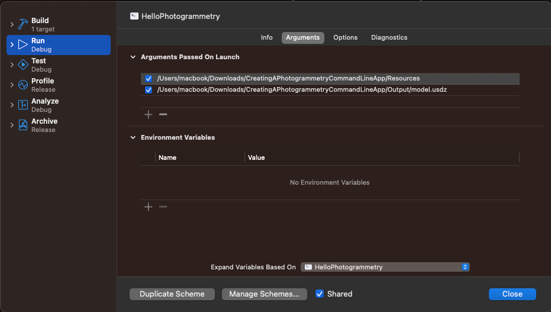
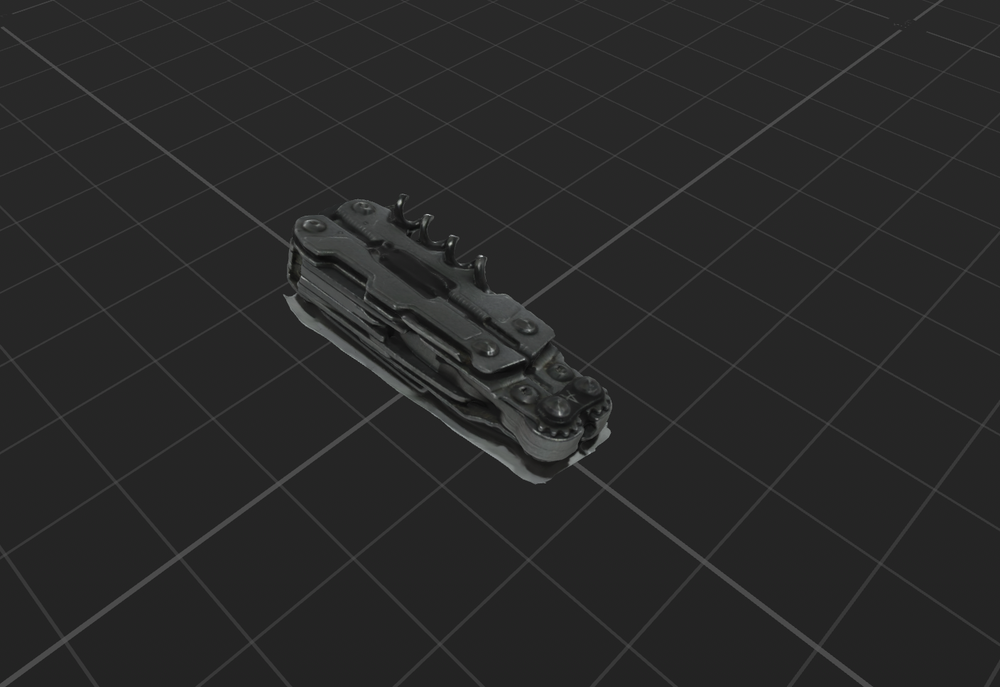
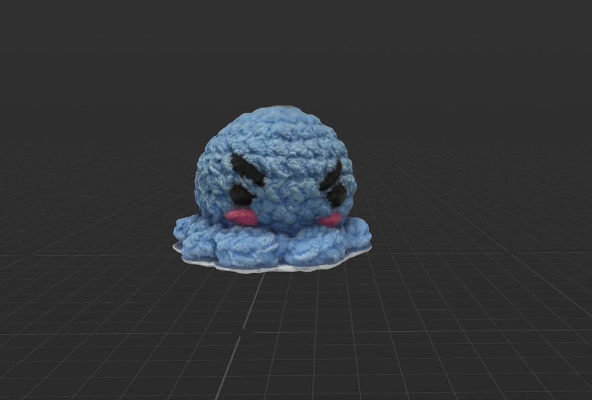

# Photogrammetry — Apple's Object Capture API

**Kuzlo Ivan, Kosyi Vlad · 1.03.2024**

Research into creating 3D models (`.usdz`) on macOS from a series of photographs
using Apple's Object Capture API and RealityKit.

## Table of contents

1. [Purpose of research](#1-purpose-of-research)
2. [Overview](#2-overview)
3. [Technologies](#3-technologies)
4. [Results](#4-results)
5. [Initial implementation](#5-initial-implementation)
6. [Conclusion](#6-conclusion)
7. [Literature](#7-literature)

## 1. Purpose of research

Explore the possibility of creating 3D models in the macOS environment.

## 2. Overview

Explore the possibility of creating 3D models using Apple's Object Capture API,
and create a sample project that generates a `.usdz` model from a series of
photographs.

## 3. Technologies

- macOS
- Apple's Object Capture API
- RealityKit

## 4. Results

Download the Apple sample
[Creating a Photogrammetry Command-Line App](https://developer.apple.com/documentation/realitykit/creating_a_photogrammetry_command-line_app).

The idea is that generation happens on the macOS side, which utilizes NPU
resources. The phone is only needed to take photos and send them to a
hypothetical macOS server.

The sample, by default, offers its own generation approach, and the results are
very good, IMHO — we weren't able to achieve such good results ourselves. We can
take 30–50 (or even 200) photos following this pattern; the more photos we take,
the better the quality of the model.

Open the project, and in the app's scheme add the path to the resources folder
and the folder for the output model as arguments:



Run the project and wait for the app to generate the model. Voilà — we have a
few ready-made models (included in [`models/`](models)):





The `.usdz` files can be opened with Quick Look, Preview, or Reality Composer.

## 5. Initial implementation

Based on Apple's
[Creating 3D objects from photographs](https://developer.apple.com/documentation/RealityKit/creating-3d-objects-from-photographs#Listen-for-updates-and-begin-creation).

**1. Create the photogrammetry session**

```swift
let inputFolderUrl = URL(fileURLWithPath: "/tmp/MyInputImages/")
let url = URL(fileURLWithPath: "MyObject.usdz")
var request = PhotogrammetrySession.Request.modelFile(url: url, detail: .full)

guard let session = try PhotogrammetrySession(input: inputFolderUrl) else {
    return
}
```

**2. Listen for updates and begin creation**

```swift
let waiter = async {
    do {
        for try await output in session.outputs {
            switch output {
            case .processingComplete:
                // RealityKit has processed all requests.
            case .requestError(let request, let error):
                // Request encountered an error.
            case .requestComplete(let request, let result):
                // RealityKit has finished processing a request.
            case .requestProgress(let request, let fractionComplete):
                // Periodic progress update. Update UI here.
            case .inputComplete:
                // Ingestion of images is complete and processing begins.
            case .invalidSample(let id, let reason):
                // RealityKit deemed a sample invalid and didn't use it.
            case .skippedSample(let id):
                // RealityKit was unable to use a provided sample.
            case .automaticDownsampling:
                // RealityKit downsampled the input images because of
                // resource constraints.
            case .processingCancelled:
                // Processing was canceled.
            @unknown default:
                // Unrecognized output.
            }
        }
    } catch {
        print("Output: ERROR = \(String(describing: error))")
        // Handle error.
    }
}
```

Once you've created a session and registered to receive status updates, start
the object-creation process by calling `process(requests:)`. RealityKit
processes the photographs in the background and notifies your app when the
process completes or fails.

## 6. Conclusion

RealityKit lets you relatively easily assemble a `.usdz` model from a set of
photos, but it all depends on the quality and quantity of the photos. The more
photos taken at the right angle, the higher the quality of the resulting model.

## 7. Literature

- WWDC video — https://developer.apple.com/videos/play/wwdc2021/10076/
- Capturing photographs for RealityKit Object Capture —
  https://developer.apple.com/documentation/RealityKit/capturing-photographs-for-realitykit-object-capture
- Creating 3D objects from photographs —
  https://developer.apple.com/documentation/RealityKit/creating-3d-objects-from-photographs
- Medium tutorial —
  https://taeeun-kim.medium.com/how-to-create-3d-models-with-object-capture-9b3d1226bd10
- Sample 1 — https://developer.apple.com/documentation/realitykit/creating_a_photogrammetry_command-line_app
- Sample 2 — https://developer.apple.com/documentation/realitykit/taking_pictures_for_3d_object_capture
